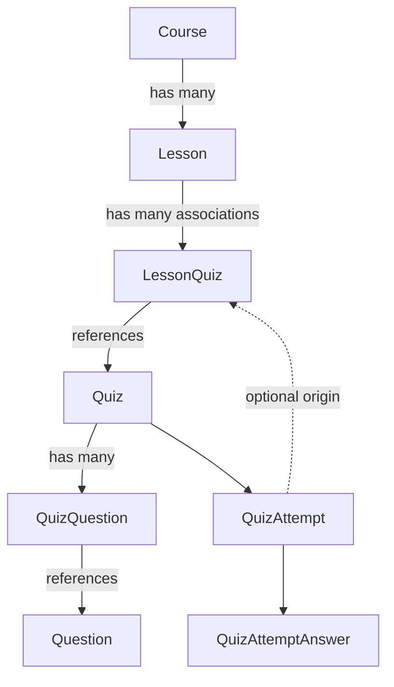
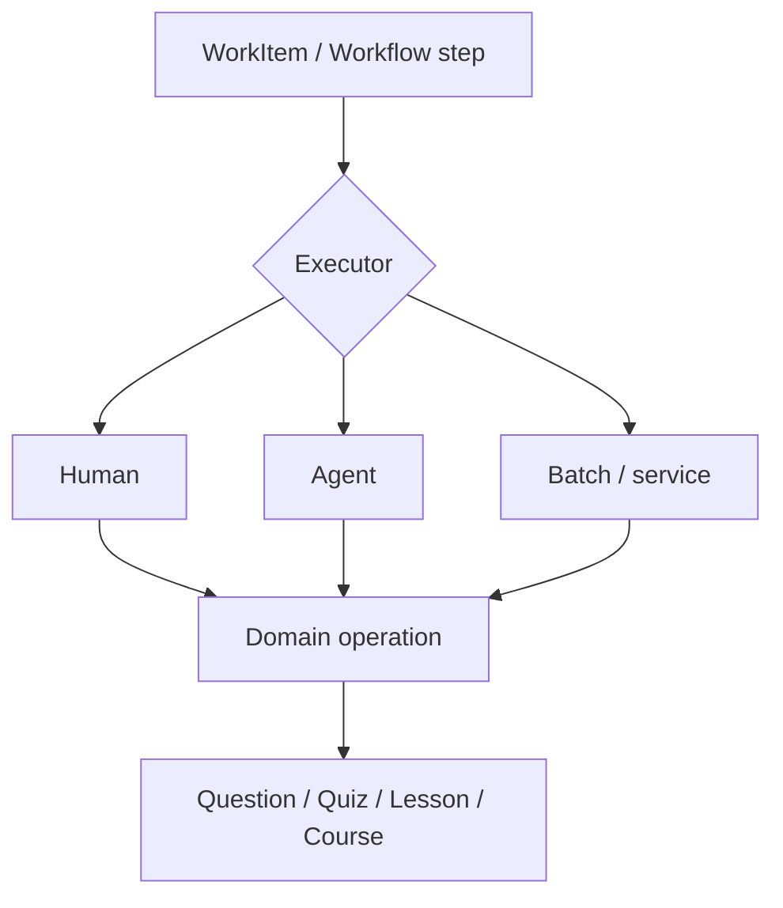

# Quiz Builder — Design Decisions and Architecture Notes

**Status:** Design snapshot; data model and reading/import UI implemented by ADR-011

**Updated:** 2026-10-21

**Purpose:** Preserve agreed domain boundaries, UI direction, and deferred decisions for coding agents working on the Quiz Builder application.

> This document describes *intended behavior and design decisions*, not a verified inventory of the repository. The course/lesson and quiz-domain migration has already been completed; agents must inspect the current code and schema before proposing changes. Do not recreate tables, endpoints, or migrations that already exist.

Implementation note (2026-10-21): [ADR-011](ADR-011-course-import-and-attempt-context.md) implements
stable association identity, persisted attempt context, public course/lesson reading, and signed-in
JSON imports. Any signed-in user may import public courses or append lessons to existing courses.
Quiz attachment and contextual player UI remain deferred; the following player flows are design
direction rather than implemented behavior.

## 1. Product boundaries

Treat the application as two related domains, not necessarily two separately deployed applications:

- **Quiz domain (V1 foundation):** Questions, quizzes, quiz composition, quiz-taking, answers, scores, and attempts. Supports personal quiz workflows independently of courses.
- **Course domain:** Public courses composed of lessons. Lessons can use quizzes from the quiz domain without changing the underlying quiz model.
- **Future content-production/orchestration domain:** Privileged course editing, agent generation, review, validation, repair, publication, and generic work items. Deliberately out of scope for current UI work.

**Dependency direction:** Courses reference/reuse quizzes; quizzes do not reference courses or lessons.



## 2. Domain relationships and invariants

### Course and Lesson

- A course can contain **zero or more lessons**.
- A lesson belongs to **exactly one course** at a time, via a required `course_id` foreign key. Do **not** introduce a course–lesson many-to-many join table.
- Lessons are **not shared** between courses. Moving a lesson means reassigning its `course_id`, if that operation is supported.
- Lessons have an ordering/position within their course.
- Courses and lessons are **public learning content** for the present design. Do not add speculative visibility, draft, review, or publication-state machinery.

### LessonQuiz

- A lesson can associate with zero or more quizzes.
- A quiz can be reused across any number of lessons (including across courses).
- Use an explicit **`LessonQuiz` association**, such as `lesson_quizzes`, with `lesson_id`, `quiz_id`, and `position`.
- Prefer a stable **`lesson_quizzes.id`** because quiz attempts may need to refer to a particular association.
- Only a **public quiz** can be associated with a lesson; a public quiz contains **only public questions**.
- Keep retry limits, passing thresholds, mandatory status, and progression rules out of `Quiz`. If eventually needed, evaluate putting lesson-specific rules on `LessonQuiz` or in a separate progression domain.
- Do not add `course_id` / `lesson_id` to `Quiz` or `Question`, nor a direct Lesson–Question relationship, without a new concrete requirement.

### Question and Quiz

- Normal user-created questions and quizzes are **private by default**.
- **Personal/private quiz:** Owner can use public questions plus the owner's private questions; access is owner-only.
- **Public quiz:** Uses public questions only; accessible to anyone under the application's quiz-access rules. These are expected mostly to be course-system artifacts or privileged/editor-created content.
- The future **permissions system and UI** for creating/managing public course content is deferred. Do not build or assume it as part of current UI work.
- **Public does not imply browsable:** A question can be usable in a public quiz without an anonymous, global question-bank UI. Do **not** add `bank_listed`, `unlisted`, or equivalent states now.
- Review states/gates and explicit question/quiz version models were intentionally removed. Do not reintroduce either through incidental UI work.
- **Historical integrity:** Content referenced by attempts must not silently change underneath recorded results. The intended simplification is effectively immutable used/published content, with replacement/retirement where appropriate. Inspect current enforcement before modifying editing behavior; the precise edit/retire policy may still require a separate decision.

## 3. Quiz attempts retain their context

**Agreed:** `QuizAttempt` should optionally reference the specific lesson/quiz association from which it was launched.

Illustrative shape (not a literal migration specification):

```ts
interface QuizAttemptContextShape {
  id: string;
  quiz_id: string;
  user_id: string | null; // retain actual repository auth/anonymous policy
  lesson_quiz_id: string | null; // null = standalone/personal attempt
  started_at: string;
  completed_at: string | null;
  score: number | null;
}
```

- `lesson_quiz_id = null`: standalone/personal quiz attempt.
- `lesson_quiz_id != null`: attempt made in the context of a particular lesson's quiz association.
- The **same quiz** can have independent attempts in different lessons and outside a lesson.
- Validate on the backend that the referenced `LessonQuiz` exists, references the attempt's `quiz_id`, and represents a context the user is allowed to access.
- Keep the lesson association's historical identity intact. Deleting or changing a `LessonQuiz` already referenced by attempts must not silently erase or falsify attempt context. Choose deletion constraints/retirement behavior based on the existing repository design.
- On results/reload, the app should be able to recover the originating lesson through the persisted attempt rather than relying entirely on frontend state or a `returnTo` URL.
- **QuizAttempt owns attempt history; the lesson UI owns the surrounding learning experience.**

## 4. UI and player decisions

### Preferred V1 experience

**Personal quiz flow:**

```text
My Quizzes -> Open/Start Quiz -> Quiz Player -> Results -> Retry or My Quizzes
```

**Lesson quiz flow:**

```text
Course -> Lesson -> Start embedded/overlay quiz
                 -> persist QuizAttempt (with lesson_quiz_id)
                 -> submit -> results within lesson context
                 -> retry or continue lesson
```

- **Preference:** Lesson quizzes should usually be **embedded directly in the lesson**, or opened as an **in-memory overlay/player** from the lesson.
- A dedicated lesson-quiz URL is **not required for V1**. Consider one later only if fullscreen navigation, direct-linking, accessibility, or restoration needs justify it.
- Even if the player UI lives in memory, **attempt state/history is persistent**. Handle reload/exit/re-entry deliberately; avoid treating browser component state as the source of truth for recorded attempts.
- Personal and lesson quiz-taking are **different surrounding workflows**, even if they reuse a common player.
- **Share quiz engine/domain behavior**: question rendering, response handling, scoring, attempt submission, and persistence as appropriate.
- **Shared page/component is optional**: one `QuizPlayer` may be practical for V1, but do not prematurely enforce a single large component with many personal-vs-lesson conditionals. Choose the implementation split after inspecting the UI and real workflow differences.
- **Editing belongs to authoring/management**, not in the running player. Personal edit/retry options should not automatically appear in lesson quizzes.
- Course/lesson-specific **next/continue** controls and retry rules belong to the contextual UI or future progression logic—not to Quiz itself.

### Tentative screen/route grouping (exploratory, not an API contract)

| UI area | Potential screens | Notes |
|---|---|---|
| Personal workspace | My Quizzes, My Questions, Quiz Builder | Private authoring/management |
| Public learning | Courses, Course Overview, Lesson | Lesson may embed quiz experience |
| Standalone quiz-taking | Quiz Player, Results | May reuse the player implementation |
| Future studio | Course Editor, Public Questions/Quizzes, Publishing | Defer privileges and editor workflows |

Do not assume a dedicated `/courses/:courseId/lessons/:lessonId/quizzes/:lessonQuizId` route is required merely because it was once considered. The current preference is the embedded/overlay flow.

## 5. Deferred features: explicitly not V1 requirements

- Course enrollment, lesson progress tracking, completion gates, unlock rules, and progression state (possible future `CourseEnrollment` / `LessonProgress`).
- Lesson-specific pass thresholds, retry limits, required assessments, diagnostic/practice classifications.
- A generic shared-context system for quiz associations beyond the concrete `LessonQuiz` context.
- Public question-bank browsing and separate bank-listing/discoverability attributes.
- Public-content editor, privileged/super-user permissions, advanced authoring screens, and course-management workflow.
- Review queues, approval gates, question/quiz versions, auto-repair, and autonomous generation pipelines.

These may influence extension points, but **should not be implemented as speculative schema or UI scaffolding**.

## 6. Possible future agentic/work-item architecture

The long-term idea is an **external orchestration layer** that can wrap domain operations as work items performed by humans, agents, or batch processes:



Examples: generate a question, validate a quiz, review a lesson, repair a problematic item, propose a replacement, or publish approved content.

Design principle: **Domain artifacts should represent usable learning content. Orchestration should track how that content is generated, checked, and repaired.** Avoid embedding generic `review_status`, `agent_state`, or `work_item_id` requirements in every domain entity before this system is designed.

No `WorkItem` schema, generic workflow engine, review queue, or agent integration is specified by this document.

## 7. Instructions for a future coding agent

1. **Inspect first:** Read actual migrations/schema, shared contracts, API endpoints, frontend routes/components, tests, and current design docs. Some earlier architecture migrations are already complete.
2. **Preserve the invariants:** Especially `Lesson -> one Course`, reusable `LessonQuiz -> public Quiz`, public quizzes -> public questions only, and nullable `QuizAttempt.lesson_quiz_id` matching the attempted quiz.
3. **Distinguish agreed vs tentative:** Persisting lesson context and preferring embedded lesson quizzes are decisions; shared component shape, route design, editing details, and progression are not finalized.
4. **Keep boundaries clear:** No lesson references on quiz/question records; no review/version logic sneaking back into quiz-taking routes; enforce authorization in the backend.
5. **Avoid speculative features:** Do not implement future editor privileges, question-bank discoverability, progression, or work-item workflows during UI scaffolding.
6. **Propose small, verifiable increments:** Start with screen responsibilities and user flows, then inspect reusable player logic, then implement minimal context-aware attempt integration. Update tests/docs for actual behavior.
7. **Flag gaps rather than inventing policy:** In particular, check existing semantics for anonymous public attempts, question/quiz editing and retirement, deletion of lesson-quiz associations, attempt recovery, and lesson access.

## 8. Key acceptance scenarios for later implementation

- A signed-in user creates a personal quiz from permitted questions and starts a standalone attempt; the attempt has no lesson context.
- A learner launches a public quiz from Lesson A; its attempt records **Lesson A's specific `LessonQuiz` association**.
- The same public quiz launched from Lesson B records **a different association** without modifying the underlying Quiz.
- A lesson results view can recover its context after a reload from persisted attempt data.
- Personal authoring controls are not exposed as lesson player controls by default.
- An attempt cannot submit a `lesson_quiz_id` that refers to a different quiz or an inaccessible lesson.
- Historical attempts retain accurate context when course/lesson quiz associations are changed or removed.

---

**Working principle:** Reuse the quiz and attempt domain across personal and course experiences, but let each UI context control navigation and learning workflow. Keep the production/review/agent system outside the learning-artifact model until its own design phase.
