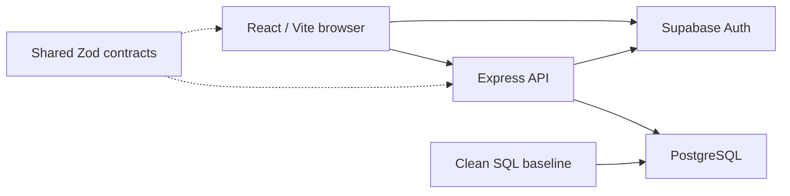

# Containers

TanStack Router owns routes and Query owns server state. Express verifies tokens, ensures profiles,
validates inputs and outputs, and runs transactional domain operations through `pg`. PostgreSQL
triggers enforce locks and cross-table access invariants. All application Data API access is closed
by RLS. Supabase-managed Auth is kept separate during the application rebuild.
