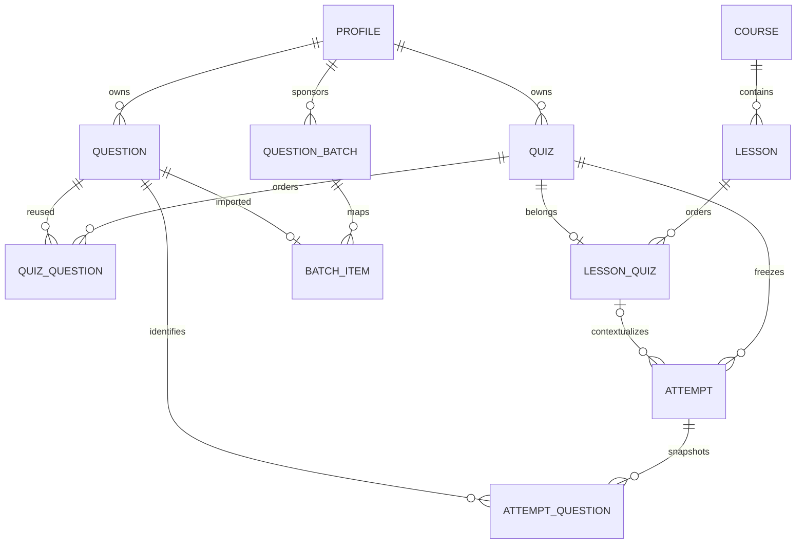

# Domain model

Questions and quizzes are direct records with private/public access. Questions lock on first quiz
use; quizzes lock on any attempt. New records replace locked content without revision identity.
Courses and lessons are public; each lesson belongs to one course. Each lesson quiz belongs to exactly one lesson and cannot be shared. Tags stay owner-scoped. Feedback triage and learner result review are retained,
independent of any content approval lifecycle. No version, publication, workflow or agent entities exist.

Signed-in users may import public courses and append lessons. Imports create no quiz associations.
Lesson editor imports create dedicated public quizzes and public questions. Any signed-in user may
edit any lesson; saving replaces changed quizzes and retires removed associations without deleting history.
Attempts retain a nullable, immutable lesson-quiz association ID independently of player UI state.
